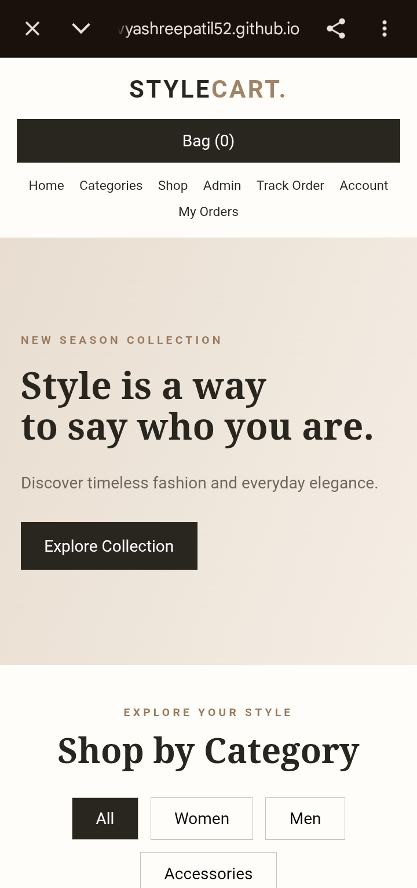

# stylecart-fashion-store

Responsive fashion e-commerce website built using HTML, CSS and JavaScript.
StyleCart — Fashion E-commerce Website

A responsive fashion e-commerce website built using HTML, CSS, and JavaScript.

Live Demo
## 📸 Website Preview

https://kavyashreepatil52.github.io/stylecart-fashion-store/

Features

- Responsive fashion storefront
- Product search and category filters
- Product sorting
- Shopping cart and wishlist
- Product details and size selection
- Checkout form
- Customer registration and login demo
- Order tracking
- My Orders section
- Admin dashboard

Technologies Used

- HTML5
- CSS3
- JavaScript
- Browser Local Storage

Project Structure

- index.html — Website structure
- style.css — Website styling
- script.js — Website functionality

Important Note

This is a frontend demonstration project. Authentication, orders, and payment options use demo functionality and browser storage. It is not connected to a secure backend or real payment gateway.

Developed By

Kavyashree Patil
